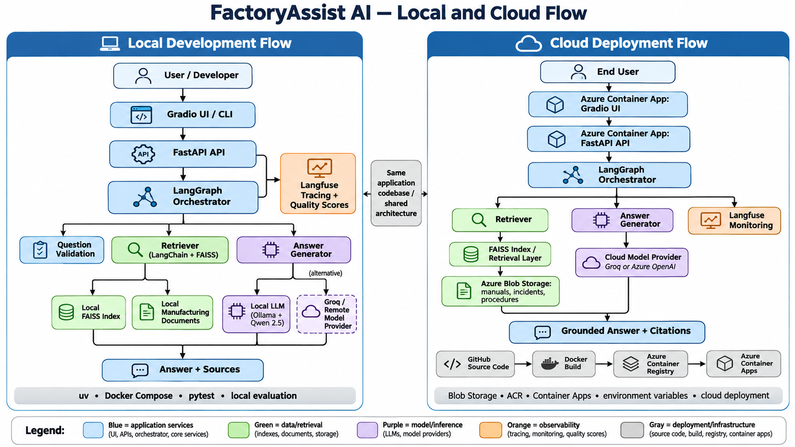

# FactoryAssist AI

### A Cloud-Deployable Manufacturing Maintenance Assistant Using RAG and LLMs

FactoryAssist AI is an end-to-end Retrieval-Augmented Generation (RAG) application designed to help manufacturing personnel retrieve maintenance information, investigate equipment errors, and access documented troubleshooting procedures through natural-language queries.

The application combines **LangChain, LangGraph, FAISS, FastAPI, and Gradio** to provide evidence-grounded responses with source citations.

It supports two execution environments using the same application codebase:

- **Local deployment:** Docker Compose, Ollama, Qwen2.5, and a locally persisted FAISS index.
- **Cloud deployment:** Azure Container Apps, Azure Blob Storage, and Groq-hosted Qwen inference.

**Langfuse** provides LLM tracing, monitoring, and evaluation across both environments.

The project uses synthetic manufacturing maintenance documents, including equipment manuals, standard operating procedures, and historical incident reports.

## Key Features

- **Evidence-grounded question answering:** Retrieves relevant maintenance documents and generates responses with source citations.
- **LangGraph orchestration:** Coordinates input validation, document retrieval, response generation, and insufficient-evidence handling.
- **Configurable model providers:** Supports local Qwen inference through Ollama and cloud-hosted Qwen through Groq.
- **Hybrid document storage:** Supports local document ingestion and Azure Blob Storage.
- **Vector similarity search:** Uses SentenceTransformers embeddings and FAISS for document retrieval.
- **Token budget management:** Applies input, retrieval-context, and generation limits to control inference usage.
- **Observability and evaluation:** Uses Langfuse for tracing and RAG quality metrics.
- **Containerised deployment:** Runs FastAPI and Gradio through Docker Compose or Azure Container Apps.

## Deployment Modes

| Component | Local | Cloud |
|---|---|---|
| Frontend | Gradio in Docker | Azure Container Apps |
| Backend | FastAPI in Docker | Azure Container Apps |
| Orchestration | LangGraph | LangGraph |
| LLM | Qwen2.5 via Ollama | Qwen via Groq API |
| Embeddings | MiniLM-L6-v2 | MiniLM-L6-v2 |
| Vector store | Local FAISS | FAISS loaded from Azure Blob |
| Monitoring | Langfuse | Langfuse |
| Container images | Docker Desktop | Azure Container Registry |

The shared application architecture allows infrastructure and inference providers to change without duplicating the core RAG workflow.

## Installation
To install the Locally developed Factory Assistant project, please refer to the [Local Setup](docs/local-setup.md).
To install the Factory Assistant Project that is deployed on Azure, please refer to the [Azure Deployment](docs/azure-deployment.md).

## Architecture

For the complete system design, data flow, deployment
architecture, and architectural decisions, see
[System Architecture](docs/architecture.md).

The Workflow of Local and Cloud based architectures is shown below.
  

## Documentation

FactoryAssist AI supports both local development and
cloud deployment using a shared application architecture.

- [System Architecture](docs/architecture.md)
- [Local Setup](docs/local-setup.md)
- [Azure Deployment](docs/azure-deployment.md)
- [Evaluation Methodology](docs/evaluation_readme.md)

## Evaluation

The application includes retrieval and generation
evaluation using a synthetic manufacturing maintenance
dataset.

Evaluation covers retrieval relevance, source recall,
citation validity, insufficient-evidence handling,
and response quality.

Langfuse provides execution traces and quality scores
for monitoring the RAG pipeline.

See [Evaluation Methodology](docs/evaluation_readme.md)
for the evaluation setup and detailed results.

## Limitations and Future Improvements

FactoryAssist is a prototype developed using synthetic
manufacturing documents.

Current limitations include:

- A small synthetic evaluation dataset
- Identifier-based document filtering designed for
  the prototype corpus
- Approximate input-token counting
- No enterprise user authentication or role-based access
- FAISS index updates require a controlled rebuild
  and refresh process

Potential improvements include Azure AI Search,
hybrid retrieval, enterprise authentication, automated
CI/CD, and more comprehensive RAG evaluation.

## Technology Stack

**AI/ML:** LangChain, LangGraph, Qwen, SentenceTransformers, FAISS

**Backend and UI:** Python, FastAPI, Gradio

**Infrastructure:** Docker, Azure Container Apps,
Azure Container Registry, Azure Blob Storage

**Observability:** Langfuse

**Development:** uv, pytest, GitHub
