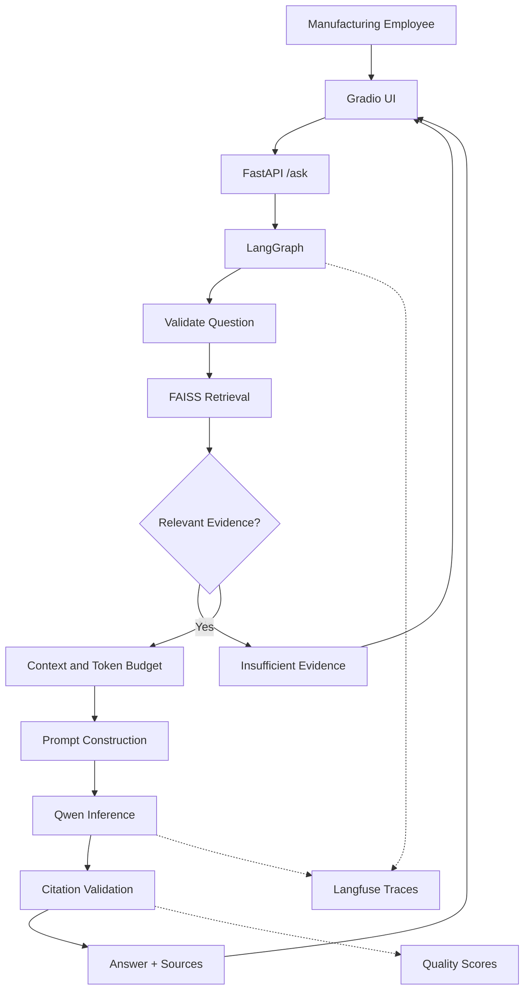

# FactoryAssist AI — System Architecture

## 1. Overview

FactoryAssist is a retrieval-augmented generation (RAG)
application for manufacturing maintenance assistance.

The architecture separates five responsibilities:

1. User interaction — Gradio
2. API layer — FastAPI
3. Workflow orchestration — LangGraph
4. Retrieval — LangChain, SentenceTransformers, FAISS
5. Generation — Ollama or Groq-hosted Qwen

Langfuse provides observability across the RAG workflow.

## 2. Request Flow



## 3. Local Deployment

- Docker Compose runs the FastAPI and Gradio services.
- Ollama hosts Qwen2.5-1.5B on the local machine.
- FAISS loads the persisted local vector index.
- SentenceTransformers produces query embeddings.
- Langfuse records traces and evaluation metrics.

Configuration:

- `MODEL_PROVIDER=ollama`
- `INDEX_SOURCE=local`

## 4. Azure Cloud Deployment

- Azure Container Registry stores the Docker image.
- Azure Container Apps runs FastAPI and Gradio.
- Gradio exposes the user interface.
- FastAPI uses internal ingress within the environment.
- Azure Blob Storage stores maintenance documents and FAISS files.
- Managed identity authenticates the API to Azure Blob Storage.
- Groq hosts Qwen3.8-27B for cloud inference.
- Langfuse provides tracing and quality monitoring.

Configuration:

- `MODEL_PROVIDER=groq`
- `INDEX_SOURCE=azure`

The same RAG orchestration and retrieval logic is reused
between local and cloud deployments.

## 5. Document Ingestion

The document ingestion pipeline:

1. Loads synthetic maintenance documents.
2. Converts them into LangChain Documents.
3. Splits documents into retrieval chunks.
4. Generates embeddings using MiniLM-L6-v2.
5. Builds and persists a FAISS vector index.

The cloud deployment downloads the previously generated
FAISS index from private Azure Blob Storage.

Index construction and question answering are separate
operations. The index is not rebuilt on every request.

## 6. LangGraph Workflow

LangGraph coordinates four primary stages:

- Validate the maintenance question.
- Retrieve relevant FAISS documents.
- Generate an evidence-grounded answer.
- Return an insufficient-evidence response when retrieval
  cannot find matching documents.

The prototype additionally filters retrieved documents
using explicit machine IDs and error codes.

This filtering approach is designed for the small
synthetic dataset and would need to be redesigned for
larger production collections.

## 7. Token Budget Management

Application-level limits control inference usage:

| Parameter | Limit |
|---|---:|
| User question | 256 estimated tokens |
| Retrieved context | 2,000 estimated tokens |
| Complete prompt | 3,000 estimated tokens |
| Generation | 384 output tokens per invocation |

Input token counts are approximate because the local
estimator does not use Qwen's native tokenizer.

Groq's reported token usage provides the actual
provider-side counts for cloud inference.

## 8. Observability

Langfuse records RAG execution traces and quality scores.

Evaluation includes:

- Retrieval recall and ranking metrics
- Citation presence
- Citation ID validity
- Citation coverage
- Status correctness
- Expected-source recall

Valid citation IDs do not by themselves establish that
every factual claim is supported by the cited documents.

## 9. Security and Limitations

- Azure credentials are obtained through managed identity.
- API keys are stored using Container Apps secrets.
- FastAPI is exposed through internal ingress.
- The public Gradio endpoint should have access restrictions.
- Only trusted FAISS metadata should be deserialized.
- Synthetic documents are used instead of confidential
  manufacturing records.

This implementation is a functional demonstration system,
not a production-certified industrial maintenance solution.
```
